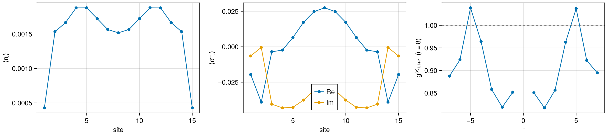

## Weakly driven atom array in a harmonic trap

A chain of $N = 11$ atoms along $\hat z$ with spacing $d = 0.2\lambda$ and dipoles along $\hat x$
sits in a harmonic light shift $V_j = \kappa (z_j - z_c)^2$. The center atom, $i = (N+1)/2$, sits
at $z_c$, and the trap depth at the edges is $4\,\Gamma_0$, so $V_j = 4(j - i)^2/(i - 1)^2$ in units
of $\Gamma_0$. A weak plane wave at normal incidence, $\Omega = 0.1\,\Gamma_0$, drives every atom in
phase. It is blue-detuned by $\Delta = 9/4$, close to the shift $V_2 = V_{10} = 64/25$, so sites 2
and 10 respond most strongly.

Besides the populations $\langle n_j\rangle$ and dipole amplitudes $\langle\sigma_j^-\rangle$, the run
measures the pair correlations of the center atom with every other atom,

```math
g^{(2)}_{i,i+r} = \frac{\langle n_i n_{i+r}\rangle}{\langle n_i\rangle\langle n_{i+r}\rangle}, \qquad r \neq 0 .
```

This is the probability of finding the center atom and the atom $r$ sites away excited together,
relative to finding them excited independently. Independent atoms have a product steady state
and $g^{(2)} = 1$ (dashed line), so any departure from 1 comes from the couplings $J_{ij}$ and
$\Gamma_{ij}$. The point $r = 0$ is left out, because $n_i^2 = n_i$ for a two-level atom.

Four things can be checked by eye here.

- Convergence: The printed eigenvalue vanishes and both residuals are small.
- Excitation balance: In the steady state the drive supplies what the array emits,
  $\langle\sum_{ij}\Gamma_{ij}\sigma_i^+\sigma_j^-\rangle = -\Omega\sum_j\operatorname{Im}\langle\sigma_j^-\rangle$,
  so the two printed numbers are equal.
- Symmetry: the chain, the trap and the in-phase drive are symmetric under
  $z_j - z_c \to -(z_j - z_c)$, which maps site $i + r$ to $i - r$. Both profiles are therefore
  symmetric about the center site, and $g^{(2)}_{i,i+r} = g^{(2)}_{i,i-r}$. The $g^{(2)}$ symmetry
  is the most sensitive of the four checks: it fails first when the solver settings are too loose.
- Weak drive: Every $\langle n_j\rangle$ is far below $1/2$.

```julia
using GLMakie
using BiorthoDMRG.Atoms: Biortho, Density2, Emission, LAMBDA, Model, chain, coherences,
    densities, driven, quadratic, steadystate

N, d, Ω = 15, 0.2LAMBDA, 0.1
ic = (N + 1) ÷ 2  # center atom i
zc = (N - 1) * d / 2  # its position
array = Model(pos = chain(N, d; axis = [0.0, 0.0, 1.0]), dipole = [1.0, 0.0, 0.0])
trapped = quadratic(array; kappa = 4.0 / zc^2, center = [0.0, 0.0, zc]) # V = 4Γ₀ at the edges
m = driven(trapped; rabi = Ω, detuning = 9 / 4) # close to V₂ = V₁₀ = 64/25

center_pairs = [Density2(min(ic, j), max(ic, j)) for j in 1:N if j != ic]
obs = [densities(N); coherences(N); center_pairs; Emission()]
backend = Biortho(;
    nsweeps = 10, 
    cutoff = 1e-20, 
    maxdim = 128,
    residual_tol = 1e-6
)
sol, res = steadystate(backend, m; observables = obs)
@show res.eigenvalue res.residuals res.kappa

n = [real(sol[Symbol("n_", j)][1]) for j in 1:N]
σ = [sol[Symbol("sm_", j)][1] for j in 1:N]
emitted, absorbed = real(sol[:emission][1]), -Ω * sum(imag, σ)
@show emitted absorbed

nn(j, k) = real(sol[Symbol("nn_", min(j, k), "_", max(j, k))][1])
rs = (1 - ic):(N - ic)
g = [r == 0 ? NaN : nn(ic, ic + r) / (n[ic] * n[ic + r]) for r in rs]

fig = Figure(size = (1500, 400))
ax1 = Axis(fig[1, 1]; xlabel = "site", ylabel = "⟨nⱼ⟩")
scatterlines!(ax1, 1:N, n)
ax2 = Axis(fig[1, 2]; xlabel = "site", ylabel = "⟨σ⁻ⱼ⟩")
scatterlines!(ax2, 1:N, real.(σ); label = "Re")
scatterlines!(ax2, 1:N, imag.(σ); label = "Im")
axislegend(ax2; position = :cb)
ax3 = Axis(fig[1, 3]; xlabel = "r", ylabel = "g⁽²⁾ᵢ,ᵢ₊ᵣ  (i = $ic)")
hlines!(ax3, [1.0]; color = :gray, linestyle = :dash)
scatterlines!(ax3, rs, g)

save("driven_trap.png", fig)
fig
```

