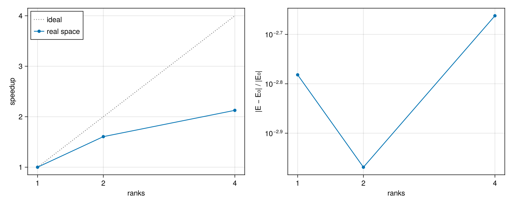

# Real-space parallel DMRG on a laptop

This example measures how splitting the chain over MPI ranks changes the time and the
accuracy of `biorthodmrg` at a fixed number of sweeps.

## Non-reciprocal XXZ chain

Here we look at the open XXZ chain of $N$ sites with non-reciprocal spin flips,

```math
H = \sum_{j=1}^{N-1} \left[ \frac{1}{2} \left( e^{g} S^+_{j+1} S^-_j + e^{-g} S^-_{j+1} S^+_j \right) + \Delta\, S^z_j S^z_{j+1} \right].
```

With $S = \exp\big(g \sum_j j\, S^z_j\big)$ we have $S S^\pm_j S^{-1} = e^{\pm g j} S^\pm_j$, so
$H = S H_0 S^{-1}$, where $H_0$ is the Hermitian chain at $g = 0$. The lowest eigenvalue of
$H$ is therefore the ground-state energy $E_0$ of $H_0$, which serial `dmrg` computes
independently.

Rank $p$ of $n$ sweeps a contiguous part of the chain. Even ranks sweep right while odd
ranks sweep left, then each pair of neighboring ranks updates the bond between their parts
together, and in the second half of the sweep the directions reverse. When $n \geq 2$
divides $N$, a rank updates the $N/n - 1$ bonds inside its part in each half-sweep and then
takes part in at most one boundary update, so with windows of equal cost a half-sweep takes
as long as $N/n$ window updates instead of $N - 1$. At $n = 1$ the sweep is that of serial
`biorthodmrg`. The parts see each other only through the boundary updates, so, unlike with
the parallel MPO, the result after a fixed number of sweeps depends on $n$.

The script `tutorials/realspace/xxz_chain.jl` runs four sweeps at fixed bond dimension,
keeps the fastest of three runs, and records the relative deviation of the energy from
$E_0$. The timing includes the initialization and the final joining of the parts on rank 0,
which do not run in parallel. Every rank uses one BLAS thread, so $n$ should not exceed the
number of performance cores. Paste this code into your REPL!

```julia
using MPI, GLMakie, BiorthoDMRG

dir, ns = joinpath(pkgdir(BiorthoDMRG), "tutorials", "realspace"), [1, 2, 4]
script = joinpath(dir, "xxz_chain.jl")
for n in ns
    MPI.mpiexec(cmd -> run(`$cmd -n $n $(Base.julia_cmd()) -t 1 --project=$(Base.active_project()) $script`))
end
t = [parse(Float64, read(joinpath(dir, "time_$n.txt"), String)) for n in ns]
err = [parse(Float64, read(joinpath(dir, "error_$n.txt"), String)) for n in ns]

fig = Figure(size = (1000, 400))
ax1 = Axis(fig[1, 1]; xlabel = "ranks", ylabel = "speedup", xticks = ns)
lines!(ax1, ns, ns; color = :gray, linestyle = :dot, label = "ideal")
scatterlines!(ax1, ns, t[1] ./ t; label = "real space")
axislegend(ax1; position = :lt)

ax2 = Axis(fig[1, 2]; xlabel = "ranks", ylabel = "|E − E₀| / |E₀|", xticks = ns, yscale = log10)
scatterlines!(ax2, ns, max.(err, eps()))

save(joinpath(dir, "speedup.png"), fig)
fig
```

