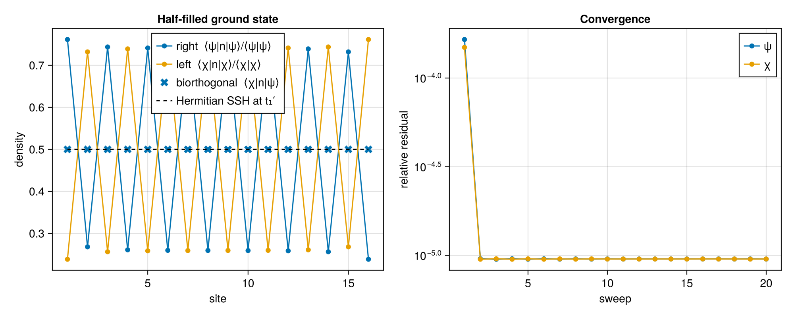
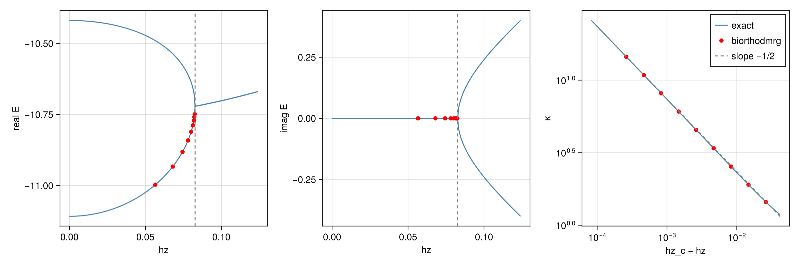

# Visual tests

The two examples below run `biorthodmrg` on models where the answer is known
independently, so the plots can be checked by eye. Both use these packages:

```julia
using ITensors, ITensorMPS, BiorthoDMRG, GLMakie
using LinearAlgebra: eigen, norm
using BiorthoDMRG.Models: ising_imaginary_field, nonreciprocal_ssh
```

## Skin effect in the non-reciprocal SSH chain

Here we look at the non-reciprocal SSH chain which makes a good first test because, on an open chain,
it is related to an ordinary Hermitian SSH chain by a similarity transformation,
so we know exactly what its left and right eigenvectors look like. Writing $H_0$
for the Hermitian chain with intracell hopping
$t_1' = \mathrm{sign}(t_1)\sqrt{t_1^2 - \gamma^2/4}$, we have

```math
H = S^{-1} H_0 S, \qquad S = \exp\Big(\sum_x \theta_x n_x\Big),
```

where $\theta_x$ increases by $\delta = \tfrac12 \ln\frac{t_1 + \gamma/2}{t_1 - \gamma/2}$
across each cell and stays constant across the bonds between cells. If
$|\psi_0\rangle$ is the ground state of $H_0$, the right eigenvector of $H$ is
$|\psi\rangle = S^{-1}|\psi_0\rangle$, and since $S$ is real and diagonal the left
eigenvector is $|\chi\rangle = S|\psi_0\rangle$.

Because $S$ commutes with every $n_x$, the biorthogonal density
$\langle\chi|n_x|\psi\rangle / \langle\chi|\psi\rangle$ is simply the density of
$|\psi_0\rangle$, and that is exactly $1/2$ on every site: the Hermitian chain is
invariant under $c_A \to c_A^\dagger$, $c_B \to -c_B^\dagger$, which sends $n_x$ to
$1 - n_x$, and its half-filled ground state is unique. The densities of
$|\psi\rangle$ and $|\chi\rangle$ on their own are more interesting. A single
particle would pile up at one edge, but in a gapped insulator at fixed filling
almost every configuration has one particle per cell, so only the intracell part
of $S$ matters and the result is a uniform stagger. In the limit $t_2 \to 0$,
$|\psi\rangle$ puts weight $(t_1 + \gamma/2)/(2t_1)$ on each A site, and
$|\chi\rangle$ is its mirror image, $n_L(x) = n_R(N + 1 - x)$, because reflecting
the chain maps $H$ to $H^T$. The same reflection makes the residuals of $\psi$ and
$\chi$ equal, so the two convergence curves should lie on top of each other.
Setting $\gamma = 0$ collapses all four density curves onto $1/2$.

Run it!
```julia
N = 16
t1, t2, γ = 1.0, 0.4, 1.0
t1′ = sign(t1) * sqrt(t1^2 - γ^2 / 4)

f = siteinds("Fermion", N)
psi0 = random_mps(f; linkdims = 8)
kw = (; nsweeps = 20, maxdim = [32, 64, 96], cutoff = 1e-12, outputlevel = 0, eigsolve_krylovdim = 8)

H = nonreciprocal_ssh(f; t1, t2, γ)
obs = BiorthoObserver(; H, residual_tol = 1e-6)
E, chi, psi = biorthodmrg(H, psi0; observer = obs, kw...)
E0, phi = dmrg(nonreciprocal_ssh(f; t1 = t1′, t2, γ = 0.0), psi0; kw...)

density(a, b) = [inner(a, apply(op("N", f[x]), b)) / inner(a, b) for x in 1:N]
nR, nL, nB, nH = density(psi, psi), density(chi, chi), density(chi, psi), density(phi, phi)
@show E E0 condition_number(chi, psi) maximum(abs ∘ imag, nB)

x = 1:N
fig = Figure(size = (1000, 400))

ax1 = Axis(fig[1, 1]; xlabel = "site", ylabel = "density", title = "Half-filled ground state")
scatterlines!(ax1, x, real.(nR); label = "right  ⟨ψ|n|ψ⟩/⟨ψ|ψ⟩")
scatterlines!(ax1, x, real.(nL); label = "left  ⟨χ|n|χ⟩/⟨χ|χ⟩")
scatter!(ax1, x, real.(nB); marker = :xcross, markersize = 14, label = "biorthogonal  ⟨χ|n|ψ⟩")
lines!(ax1, x, real.(nH); color = :black, linestyle = :dash, label = "Hermitian SSH at t₁′")
axislegend(ax1; position = :ct)

r = obs.residuals
ax2 = Axis(fig[1, 2]; xlabel = "sweep", ylabel = "relative residual", yscale = log10, title = "Convergence")
scatterlines!(ax2, 1:length(r), max.(first.(r), eps()); label = "ψ")
scatterlines!(ax2, 1:length(r), max.(last.(r), eps()); label = "χ")
axislegend(ax2)

save("ssh_skin_effect.png", fig)
fig
```



With these parameters the right density sits near 0.74 on the A sites, the left
density is its reflection, and the biorthogonal markers fall on the dashed line. As expected!

Making $\gamma$ larger increases the A/B imbalance, and with it the condition
number, which grows monotonically with $\gamma$. 

## Exceptional point of the Ising chain in an imaginary field

The second example looks at the regime where a biorthogonal method ought to
struggle, near an exceptional point. Take the open transverse-field Ising chain
in an imaginary longitudinal field,

```math
H = -J \sum_j Z_j Z_{j+1} - h_x \sum_j X_j - i h_z \sum_j Z_j .
```

It is not Hermitian, but it is PT-symmetric with $P = \prod_j X_j$ and $T$ complex
conjugation: $P$ flips the sign of each $Z_j$ and $T$ flips the sign of $i$, so
$PT$ commutes with $H$. Since $PT$ is antiunitary, $H|\psi\rangle = E|\psi\rangle$
implies $H\,PT|\psi\rangle = \bar E\,PT|\psi\rangle$, and every eigenvalue is either
real or one of a complex-conjugate pair. In the paramagnetic phase the two lowest
levels approach each other as $h_z$ grows, meet at an exceptional point $h_z^c$,
and continue as a conjugate pair. Close to $h_z^c$ the problem behaves like a
two-level system, which predicts that the eigenvalue condition number diverges as
$\kappa \propto (h_z^c - h_z)^{-1/2}$.

The code finds $h_z^c$ by exact diagonalization, runs `biorthodmrg` at
logarithmically spaced distances below it, and compares the energies and
condition numbers with the exact ones.


Run it!
```julia
N, hx = 8, 1.2 # paramagnetic, so the ground state at hz = 0 is unique
s = siteinds("S=1/2", N)
psi0 = random_mps(s; linkdims = 4)
kw = (; nsweeps = 15, maxdim = 32, cutoff = 1e-12, outputlevel = 0, eigsolve_krylovdim = 10)

# exact two lowest levels (by real part) and the condition number of the lowest
function levels(hz)
    H = ising_imaginary_field(s; hx, hz)
    F = eigen(reshape(Array(prod(H[k] for k in 1:N), prime.(s)..., s...), 2^N, 2^N))
    i, j = sortperm(
        F.values; by = λ -> (round(real(λ); digits = 10), imag(λ))
    )[1:2]
    return F.values[i], F.values[j], norm(F.vectors[:, i]) * norm(inv(F.vectors)[i, :])
end

# the exceptional point is where the lowest level first turns complex
iscomplex(hz) = abs(imag(levels(hz)[1])) > 1e-6
function exceptional_point()
    lo, hi = 0.0, 0.1
    while !iscomplex(hi)
        hi < 100 || error("no exceptional point below hz = 100")
        hi *= 2
    end
    for _ in 1:40
        mid = (lo + hi) / 2
        iscomplex(mid) ? (hi = mid) : (lo = mid)
    end
    return (lo + hi) / 2
end

hz_c = exceptional_point()
hzs = range(0, 1.5hz_c; length = 301)
spec = levels.(hzs)
δs = hz_c .* exp10.(range(-0.3, -3; length = 60))
κ_exact = [levels(hz_c - δ)[3] for δ in δs]

δ_dmrg = hz_c .* exp10.(range(-0.5, -2.5; length = 9))
runs = map(δ_dmrg) do δ
    E, chi, psi = biorthodmrg(
        ising_imaginary_field(s; hx, hz = hz_c - δ), psi0; kw...
    )
    E, condition_number(chi, psi)
end
E_dmrg, κ_dmrg = first.(runs), last.(runs)

fig = Figure(size = (1200, 400))
for (col, part) in enumerate((real, imag))
    ax = Axis(fig[1, col]; xlabel = "hz", ylabel = "$part E")
    lines!(ax, hzs, part.(getindex.(spec, 1)); color = :steelblue)
    lines!(ax, hzs, part.(getindex.(spec, 2)); color = :steelblue)
    scatter!(ax, hz_c .- δ_dmrg, part.(E_dmrg); color = :red)
    vlines!(ax, [hz_c]; color = :gray, linestyle = :dash)
end
ax = Axis(fig[1, 3]; xlabel = "hz_c − hz", ylabel = "κ", xscale = log10, yscale = log10)
lines!(ax, δs, κ_exact; color = :steelblue, label = "exact")
scatter!(ax, δ_dmrg, κ_dmrg; color = :red, label = "biorthodmrg")
lines!(ax, δs, κ_exact[end] .* sqrt.(δs[end] ./ δs); color = :gray, linestyle = :dash, label = "slope −1/2")
axislegend(ax; position = :rt)

save("ising_exceptional_point.png", fig)
fig
```



In the first two panels the real parts of the two lowest levels merge at the
dashed line, while their imaginary parts, zero up to that point, open up
symmetrically. The `biorthodmrg` energies, in red, sit on the lower branch with
vanishing imaginary part. In the last panel the condition numbers from
`biorthodmrg` fall on the exact curve, and both bend toward the slope $-1/2$ as
$h_z$ approaches $h_z^c$. As expected!